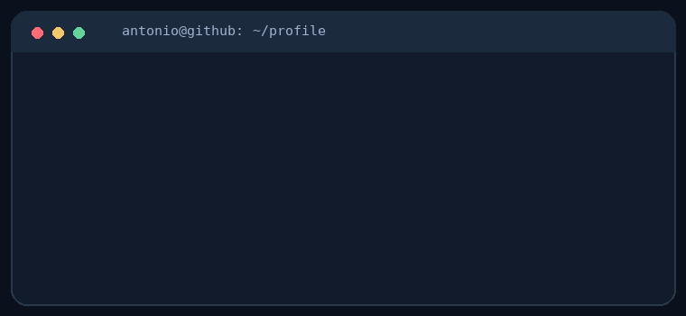

# Antonio Giannini

**Computer Science Student · Software Development · Cybersecurity**

Building secure applications, learning modern software engineering, and exploring AI-powered solutions.

## About me

I'm a Computer Science student based in Recife, Brazil 🇧🇷, interested in building practical, reliable software.

- **Currently exploring:** Software Engineering, Cybersecurity, AI, FastAPI, React, and Cloud Technologies.
- **I enjoy:** Backend development, APIs, automation, and turning ideas into working products.
- **My goal:** Grow as a software engineer and contribute to meaningful projects.

  

## Tech stack

**Languages**

    

**Frameworks & tools**

     

**Databases**

  

## Featured projects

### [CyberSentinel](https://github.com/AntonioGiannini-BR/CyberSentinel)
A cybersecurity dashboard for analyzing logs, identifying suspicious login activity, and generating reports.

`Python` · `Flask` · `SQLite` · `Docker`

### PulseOps AI
A software engineering project exploring API development, structured workflows, and AI-oriented features.

`API Development` · `Software Engineering` · `AI`

> More projects are available in my [repositories](https://github.com/AntonioGiannini-BR?tab=repositories).

## GitHub activity

  
  

## Contribution activity

<picture>
  <source media="(prefers-color-scheme: dark)"
    srcset="https://raw.githubusercontent.com/AntonioGiannini-BR/AntonioGiannini-BR/pacman-output/pacman-contribution-graph-dark.svg?game=pacman">
  <source media="(prefers-color-scheme: light)"
    srcset="https://raw.githubusercontent.com/AntonioGiannini-BR/AntonioGiannini-BR/pacman-output/pacman-contribution-graph.svg?game=pacman">
  
</picture>

